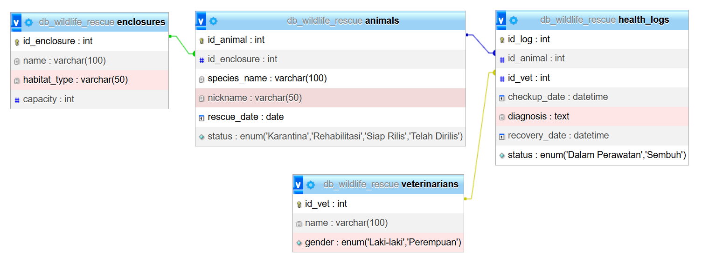

# Janji
Saya R Mohammad Fikry Mushoffa S dengan NIM 2502049 mengerjakan Tugas Praktikum 7 pada Mata Kuliah Desain dan Pemrograman Berorientasi Objek (DPBO) untuk keberkahan-Nya maka saya tidak melakukan kecurangan seperti yang telah dispesifikasikan. Aamiin

# Wildlife Rescue Center (Sistem Informasi Karantina & Rehabilitasi Satwa)

Sistem berbasis PHP sederhana untuk mengelola fasilitas kandang karantina, data satwa yang diselamatkan, data dokter hewan, dan catatan rekam medis pemeriksaan kesehatan satwa.

# Fitur Utama

Sistem ini menyediakan fungsionalitas CRUD (Create, Read, Update, Delete) lengkap untuk empat entitas utama:

* **Fasilitas Kandang (Enclosures):** Mendata nama kandang, tipe habitat (`Udara`, `Terestrial`, `Akuatik`, `Amfibi`), dan kapasitas maksimal penampungan hewan.
* **Data Satwa (Animals):** Mendata spesies satwa, nama panggilan, tanggal penyelamatan, kandang penempatan, dan status satwa (`Karantina`, `Rehabilitasi`, `Siap Rilis`, `Telah Dirilis`).
* **Dokter Hewan (Veterinarians):** Mendata nama dokter hewan dan jenis kelamin dokter penanggung jawab pemeriksaan.
* **Rekam Medis (Health Logs):** Mencatat pemeriksaan kesehatan satwa, dokter yang memeriksa, diagnosa, waktu cek, waktu selesai rawat, dan status kesembuhan (`Dalam Perawatan`, `Sembuh`). Dilengkapi tombol aksi khusus **Selesai Rawat** yang otomatis mengubah status catatan menjadi sembuh dan memperbarui status satwa menjadi siap rilis.

# Struktur Proyek

Proyek ini menggunakan arsitektur OOP terstruktur, di mana file Class bertindak untuk logika database dan file PHP di folder `view/` bertindak sebagai antarmuka (tampilan).

```
Main
├── Program
│   ├── class/
│   │   ├── Enclosure.php
│   │   │   ├── create()
│   │   │   ├── readAll()
│   │   │   ├── getById([ID])
│   │   │   ├── update()
│   │   │   └── delete()
│   │   ├── Animal.php
│   │   │   ├── create()
│   │   │   ├── readAll()
│   │   │   ├── getById([ID])
│   │   │   ├── update()
│   │   │   └── delete()
│   │   ├── Veterinarian.php
│   │   │   ├── create()
│   │   │   ├── readAll()
│   │   │   ├── getById([ID])
│   │   │   ├── update()
│   │   │   └── delete()
│   │   └── HealthLog.php
│   │       ├── create()
│   │       ├── readAll()
│   │       ├── getById([ID])
│   │       ├── update()
│   │       ├── completeTreatment([ID])
│   │       └── delete()
│   │
│   ├── config/
│   │   ├── conf.php
│   │   └── db.php
│   │
│   ├── database/
│   │   └── db_wildlife_rescue.sql
│   │
│   ├── view/
│   │   ├── animals.php
│   │   ├── enclosures.php
│   │   ├── health_logs.php
│   │   └── veterinarians.php
│   │
│   ├── index.php
│   └── styles.css
│
├── Dokumentasi
│   ├── Diagram.png
│   └── Record.mp4
│
└── README.md
```

# Diagram


# Database

```sql
CREATE DATABASE IF NOT EXISTS db_wildlife_rescue;
USE db_wildlife_rescue;

-- 1. Tabel enclosures
CREATE TABLE enclosures (
    id_enclosure INT AUTO_INCREMENT PRIMARY KEY,
    name VARCHAR(100) NOT NULL,
    habitat_type VARCHAR(50) NOT NULL,
    capacity INT NOT NULL
);

-- 2. Tabel animals
CREATE TABLE animals (
    id_animal INT AUTO_INCREMENT PRIMARY KEY,
    id_enclosure INT NOT NULL,
    species_name VARCHAR(100) NOT NULL,
    nickname VARCHAR(50) NOT NULL,
    rescue_date DATE NOT NULL,
    status ENUM('Karantina', 'Rehabilitasi', 'Siap Rilis', 'Telah Dirilis') NOT NULL DEFAULT 'Karantina',
    FOREIGN KEY (id_enclosure) REFERENCES enclosures(id_enclosure) ON DELETE CASCADE ON UPDATE CASCADE
);

-- 3. Tabel veterinarians
CREATE TABLE veterinarians (
    id_vet INT AUTO_INCREMENT PRIMARY KEY,
    name VARCHAR(100) NOT NULL,
    gender ENUM('Laki-laki', 'Perempuan') NOT NULL
);

-- 4. Tabel health_logs
CREATE TABLE health_logs (
    id_log INT AUTO_INCREMENT PRIMARY KEY,
    id_animal INT NOT NULL,
    id_vet INT NOT NULL,
    checkup_date DATETIME NOT NULL,
    diagnosis TEXT NOT NULL,
    recovery_date DATETIME DEFAULT NULL,
    status ENUM('Dalam Perawatan', 'Sembuh') NOT NULL DEFAULT 'Dalam Perawatan',
    FOREIGN KEY (id_animal) REFERENCES animals(id_animal) ON DELETE CASCADE ON UPDATE CASCADE,
    FOREIGN KEY (id_vet) REFERENCES veterinarians(id_vet) ON DELETE CASCADE ON UPDATE CASCADE
);
```

# Dokumentasi
Dokumentasi demonstrasi fitur CRUD dan pengoperasian sistem dapat dilihat pada berkas video di folder `Dokumentasi/Record.mp4`.
